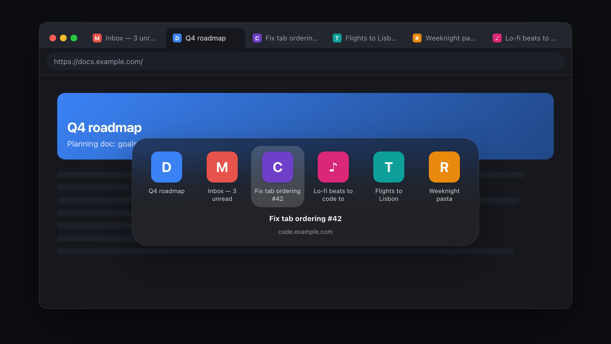

<p align="center">
  
</p>

<h1 align="center">Option-Tab Switcher</h1>

<p align="center">
  <b>⌘Tab, but for your Chrome tabs.</b><br>
  Hold <kbd>⌥</kbd>, tap <kbd>Tab</kbd>. It uses the same keys and the same most-recently-used order as the macOS app switcher.
</p>

<p align="center">
  <a href="https://dereviankoandrew.github.io/option-tab-switcher/"><b>Website &amp; live demo</b></a> ·
  <a href="https://github.com/DereviankoAndrew/option-tab-switcher/releases/latest/download/option-tab-switcher.zip"><b>Download</b></a> ·
  <a href="#install">Install</a> ·
  <a href="#faq">FAQ</a>
</p>

<p align="center">
  
</p>

---

## Why

<kbd>Ctrl</kbd>+<kbd>Tab</kbd> goes through tabs from left to right, but most of the time you want **the tab you were just on**.
macOS solved this for apps with <kbd>⌘</kbd>+<kbd>Tab</kbd>. This extension does the same for Chrome tabs, with the same keys and
the same logic:

- **Quick tap** <kbd>⌥</kbd><kbd>Tab</kbd> flips between your two most recent tabs, without the switcher flashing on screen.
- **Hold** <kbd>⌥</kbd> and keep pressing <kbd>Tab</kbd> to go further back in your history, then let go to switch.
- **Across all windows.** Picking a tab in another window brings that window to the front.
- **Looks like macOS.** A frosted-glass panel that follows light and dark mode.
- **Private.** No servers, analytics or accounts. The tab order stays in your browser's session storage.

## Shortcuts

| Keys | Action |
| --- | --- |
| <kbd>⌥</kbd> <kbd>Tab</kbd> (quick tap) | Go back to the previously used tab |
| Hold <kbd>⌥</kbd>, press <kbd>Tab</kbd> | Open the switcher; each <kbd>Tab</kbd> moves right |
| <kbd>⌥</kbd> <kbd>⇧</kbd> <kbd>Tab</kbd> · <kbd>⌥</kbd> <kbd>`</kbd> · <kbd>←</kbd> | Move left |
| <kbd>→</kbd> | Move right |
| Release <kbd>⌥</kbd> · <kbd>Enter</kbd> | Switch to the selected tab |
| <kbd>Esc</kbd> | Cancel |
| <kbd>Q</kbd> · <kbd>W</kbd> (while open) | Close the selected tab, like <kbd>⌘</kbd><kbd>Tab</kbd> + <kbd>Q</kbd> quits an app |
| Hover · Click | Select / switch with the mouse |

## Install

The extension isn't on the Chrome Web Store yet, so you load it unpacked:

1. Download **[option-tab-switcher.zip](https://github.com/DereviankoAndrew/option-tab-switcher/releases/latest/download/option-tab-switcher.zip)** and unzip it somewhere permanent
   (or clone this repo and use the `extension/` folder).
2. Open `chrome://extensions`.
3. Turn on **Developer mode** (top-right).
4. Click **Load unpacked** and choose the unzipped folder.
5. Press <kbd>⌥</kbd><kbd>Tab</kbd> on any web page.

Tabs that were already open start working straight away. You don't need to reload them.

## How it works

```
extension/
├── manifest.json   Manifest V3
├── background.js   Service worker: keeps every tab in most-recently-used order, does the switching
└── content.js      Catches the ⌥/Tab keys in each page and draws the switcher (shadow DOM)
```

- **Most-recently-used order.** The background worker moves a tab to the front whenever it's activated in the focused
  window, or when its window gains focus. The list is saved in `chrome.storage.session`, so it survives the service
  worker being suspended. On first run, it's built from `tab.lastAccessed`.
- **Key handling.** Chrome's `commands` API doesn't accept <kbd>Tab</kbd> and can't detect a modifier being released,
  and both are needed for ⌘Tab-style switching. So a content script listens for `keydown`/`keyup` in the page, at capture
  phase, before the page's own handlers. Keys pressed inside iframes are forwarded to the top frame, which owns the UI.
- **Quick tap vs. hold.** The switcher only appears if <kbd>⌥</kbd> is still held after 150 ms. Shorter taps switch
  straight away, like on macOS.

### Permissions

| Permission | Why |
| --- | --- |
| `tabs` | List tabs (titles, URLs) and switch between them |
| `storage` | Keep the most-recently-used order while the service worker sleeps |
| `favicon` | Show each site's icon in the switcher |
| `scripting` + all sites | Listen for ⌥ Tab on every page, and add the script to tabs that were already open |

Nothing is sent over the network.

## FAQ

<details>
<summary><b>Why doesn't ⌥ Tab work on the New Tab page or <code>chrome://</code> pages?</b></summary>

Chrome doesn't let extensions run scripts on its own pages: the New Tab page, `chrome://…` and the Web Store. It also
doesn't let an extension shortcut use <kbd>Tab</kbd>. For those pages, bind the fallback command **"Switch to the
previously used tab"** at `chrome://extensions/shortcuts`.
</details>

<details>
<summary><b>It doesn't react while I'm typing in the address bar.</b></summary>

The address bar and DevTools belong to Chrome itself, not the page, so the extension can't see keys pressed there.
Click into the page (or press <kbd>Esc</kbd>) first.
</details>

<details>
<summary><b>Windows / Linux?</b></summary>

It's built for macOS. On Windows and most Linux desktops, <kbd>Alt</kbd>+<kbd>Tab</kbd> is taken by the operating
system before Chrome ever sees it.
</details>

<details>
<summary><b>Another app already uses ⌥ Tab.</b></summary>

Window-switcher apps that grab <kbd>⌥</kbd><kbd>Tab</kbd> system-wide get it first. Change the shortcut in that app,
or use the fallback command.
</details>

## Contributing

Issues and pull requests are welcome. There's no build step: edit the files in `extension/`, then click the reload
icon on the extension's card in `chrome://extensions`. The website is the static page in `docs/`, served by GitHub Pages.

## License

[MIT](LICENSE) © Andrii Derevianko. Not affiliated with Apple or Google.
